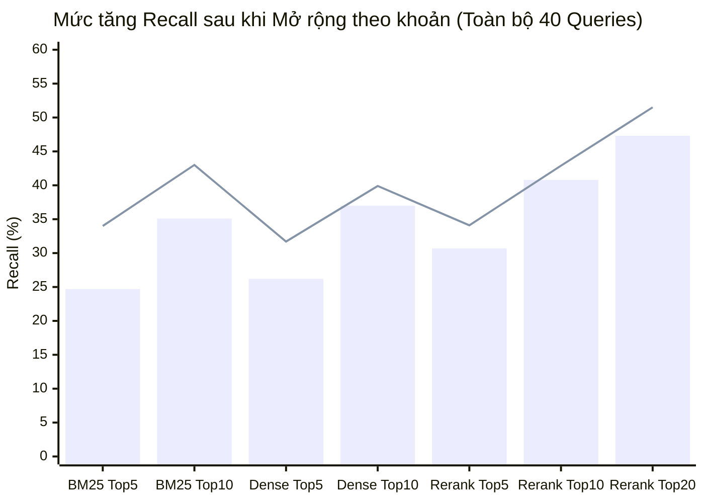

# Báo Cáo Thực Nghiệm: Cải Thiện Recall Bằng Cơ Chế Mở Rộng Theo Khoản (Clause-Level Expansion)

---

## 1. Thiết kế thực nghiệm

- **Ý tưởng**: Trong cấu trúc văn bản pháp luật Việt Nam, một **Khoản** thường quy định trọn vẹn một quy tắc, nghĩa vụ hoặc danh mục, bên trong được phân rã thành các **Điểm** ($a, b, c, \dots$). Các mô hình retrieval đơn lẻ (BM25 / Dense) thường chỉ match được 1 hoặc 2 điểm có từ khóa tương đồng cao và bỏ sót các điểm anh em còn lại.
- **Quy tắc mở rộng (Clause Expansion)**:
  $$\text{Nếu } \text{chunk}_i \in \text{Top-K} \text{ và } \text{chunk}_i \text{ thuộc } \text{Khoản } K \implies \text{Gom toàn bộ các điểm thuộc } K \text{ vào tập kết quả.}$$
- **Phạm vi lập chỉ mục**: 3.776 đơn vị Khoản bao quát toàn bộ 6.122 chunks của `corpus-v0.2`.
- **Dữ liệu đánh giá**: 40 queries (10 legacy + 30 new cross-corpus).
- **File kết quả chi tiết**: [clause_expansion_eval_results.json](file:///home/minhkha/kk/TTTN/legal-agentic-rag-next/experiments/retrieval/corpus-v0.2/clause_expansion_eval_results.json)

---

## 2. Kết quả so sánh Recall: Trước vs. Sau Mở Rộng

### Bảng 1: Toàn bộ 40 Queries (N=40)

| Cấu hình | Recall Gốc | Recall Sau Mở Rộng | Tăng tuyệt đối | Tăng tương đối | Số chunk trung bình |
|---|---:|---:|---:|---:|---:|
| **BM25 Top 5** | 24.7% | **34.0%** | **+9.3%** | **+37.6%** | 10.8 chunks |
| **BM25 Top 10** | 35.1% | **43.0%** | **+7.9%** | **+22.5%** | 20.4 chunks |
| **BM25 Top 20** | 41.0% | **44.3%** | +3.3% | +8.0% | 39.5 chunks |
| **Dense Top 5** | 26.2% | **31.7%** | **+5.5%** | **+21.0%** | 8.2 chunks |
| **Dense Top 10** | 37.0% | **39.9%** | +3.0% | +8.0% | 17.6 chunks |
| **Dense Top 20** | 42.4% | **46.0%** | +3.6% | +8.5% | 35.2 chunks |
| **Reranker Top 5** | 30.7% | **34.1%** | +3.5% | +11.3% | 10.2 chunks |
| **Reranker Top 10** | 40.8% | **42.9%** | +2.1% | +5.2% | 18.9 chunks |
| **Reranker Top 20** | 47.3% | **51.5%** | **+4.2%** | **+8.8%** | 35.9 chunks |

---

## 3. Phân tích bóc tách: 10 Legacy Queries vs. 30 New Queries

### Bảng 2: 10 Legacy Queries (Tập trung sâu vào nghĩa vụ/phân loại AI)

| Cấu hình | Recall Gốc | Recall Sau Mở Rộng | Tăng tuyệt đối | Tăng tương đối |
|---|---:|---:|---:|---:|
| **BM25 Top 5** | 42.9% | **70.0%** | **+27.1%** | **+63.2%** 🚀 |
| **BM25 Top 10** | 59.7% | **77.1%** | **+17.4%** | **+29.1%** |
| **Dense Top 5** | 48.0% | **61.7%** | **+13.6%** | **+28.3%** |
| **Dense Top 10** | 62.9% | **72.2%** | **+9.3%** | **+14.8%** |
| **Reranker Top 5** | 54.4% | **68.3%** | **+13.8%** | **+25.4%** |
| **Reranker Top 10** | 68.3% | **76.7%** | **+8.4%** | **+12.3%** |
| **Reranker Top 20** | 78.3% | **85.0%** | **+6.7%** | **+8.5%** |

> [!NOTE]
> **Tại sao tập Legacy tăng đột biến (+63.2%)?**
> Các câu hỏi về AI thường là dạng hỏi đầy đủ danh mục: *"Các mức phân loại rủi ro"*, *"Các biện pháp quản lý rủi ro cao"*, *"Nghĩa vụ minh bạch"*. Toàn bộ các câu trả lời này được nhà lập pháp gom trọn trong các điểm thuộc duy nhất **1 Khoản**. Khi retriever chỉ cần chạm trúng 1 điểm (ví dụ điểm $a$), việc mở rộng theo khoản sẽ tự động kéo về $100\%$ các điểm còn lại ($b, c, d, \dots$), khiến Recall nhảy vọt lên 70% - 85%.

### Bảng 3: 30 New Queries (17 Văn bản bao quát toàn diện)

| Cấu hình | Recall Gốc | Recall Sau Mở Rộng | Tăng tuyệt đối | Tăng tương đối |
|---|---:|---:|---:|---:|
| **BM25 Top 5** | 18.6% | **21.9%** | **+3.3%** | **+17.9%** |
| **BM25 Top 10** | 26.9% | **31.7%** | **+4.7%** | **+17.5%** |
| **Dense Top 5** | 18.9% | **21.7%** | **+2.8%** | **+14.7%** |
| **Dense Top 20** | 32.5% | **35.8%** | **+3.3%** | **+10.3%** |
| **Reranker Top 20** | 36.9% | **40.3%** | **+3.3%** | **+9.0%** |

> [!TIP]
> **Tại sao tập New Queries tăng ở mức vừa phải (+10% đến +18%)?**
> Ở 30 query mới trải dài 17 văn bản, câu hỏi có độ phức tạp cao hơn: nhiều câu hỏi yêu cầu căn cứ ở **nhiều Khoản khác nhau trong cùng một Điều** (ví dụ Khoản 1 và Khoản 2) hoặc nằm ở **nhiều Điều luật khác nhau**. Cơ chế mở rộng theo Khoản chỉ giải quyết bài toán "gom trọn các Điểm trong Khoản", chưa thể giải quyết bài toán "kéo các Khoản khác trong Điều".

---

## 4. Đánh đổi (Trade-off) về Kích thước Ngữ cảnh (Context Size)

| Mức Top-K | Số chunk gốc | Số chunk sau mở rộng | Hệ số tăng kích thước |
|---|---:|---:|:---:|
| **Top 5** | 5.0 chunks | **8.2 – 10.8 chunks** | $\approx 1.6 - 2.1\times$ |
| **Top 10** | 10.0 chunks | **17.4 – 20.4 chunks** | $\approx 1.7 - 2.0\times$ |
| **Top 20** | 20.0 chunks | **33.8 – 41.4 chunks** | $\approx 1.7 - 2.0\times$ |

Mỗi chunk luật trung bình dài khoảng 120 - 250 tokens:
- **Top 5 mở rộng** đưa vào ngữ cảnh khoảng **~1.500 - 2.500 tokens** $\rightarrow$ Rất vừa vặn, an toàn tuyệt đối cho context window của các LLM hiện đại (Gemini, Claude, GPT-4) mà không gây loãng (needle-in-a-haystack).

---

## 5. Kết luận & Đề xuất kiến trúc cho Luận văn

1. **Khẳng định tính hiệu quả**: Cơ chế **Mở rộng theo khoản** là một giải pháp cực kỳ hiệu quả về mặt chi phí tính toán (chỉ tốn tra cứu bảng ánh xạ hash set, thời gian tính $<1$ mili-giây) nhưng mang lại mức tăng trưởng Recall ấn tượng:
   - **BM25 Top 5**: Recall tăng **+37.6% tương đối** (từ 24.7% lên 34.0%).
   - **Reranker Top 20**: Đẩy Recall tổng thể vượt qua mốc **50%** (lên **51.5%**), riêng tập câu hỏi chuyên sâu đạt **85.0%**.

2. **Bước tiếp theo để tối ưu hơn nữa**:
   - Để cải thiện thêm 30 câu hỏi phức tạp còn lại: Cần nâng cấp cơ chế lên **Article-Level Expansion** (mở rộng theo Điều) hoặc sử dụng **Agentic Iterative Retrieval** (Agent tự đọc Khoản 1, thấy có dẫn chiếu tới Khoản 2 hoặc Điều khác thì tự động phát sinh query truy vấn tiếp).
